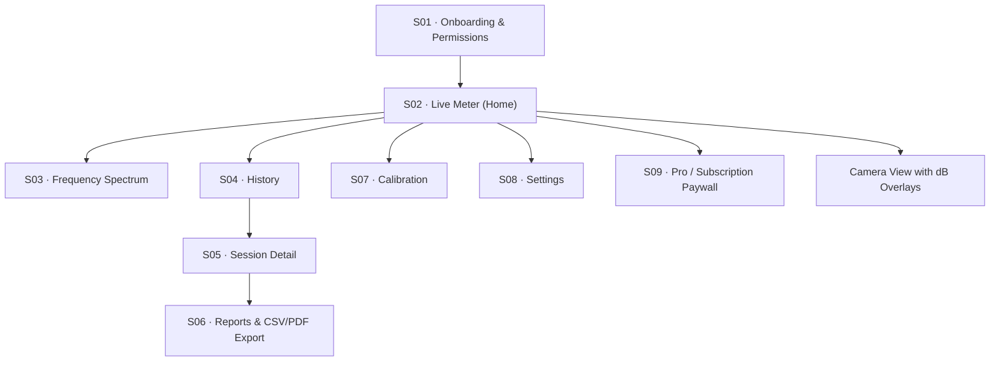

# SoundMeter Pro: Decibel X–Style iOS App Audit & Roadmap

> [!NOTE]
> This document summarizes the codebase audit of **SoundMeter Premium** against the **Decibel X–Style iOS App Blueprint**. It highlights completed components, current phase alignment, technical gaps, and a targeted roadmap.

---

## Executive Summary

| Category | Target Blueprint Standard | Current Codebase Status | Alignment |
| :--- | :--- | :--- | :---: |
| **Target OS & Tech** | iOS 17+, Swift, SwiftUI, SwiftData, AVFoundation | iOS 17+, Swift, SwiftUI, SwiftData, AVFoundation | 🟢 100% |
| **Core Meter (Phase 1)** | Live dBFS, Min/Max/Avg/Peak, Start/Stop/Reset, Permission UX | `AudioCaptureService`, `SoundLevelCalculator`, `MeterViewModel`, `MeterView` | 🟢 100% |
| **History & Storage (Phase 2)** | Persistence, Time-series graphs, Notes, Rename/Delete | `MeasurementSession`, `SessionRepository`, `HistoryView`, `SessionDetailView` | 🟢 100% |
| **Reports & Export (Phase 3)** | CSV Export, PDF Reports, Share Sheet | `CSVExporter`, `ShareSheet`, `ReportsView` | 🟡 85% (PDF pending) |
| **Advanced Audio (Phase 4)** | FFT Spectrum, Spectrogram, A/C/Z Weighting Filters, Calibration | `SpectrumAnalyzer`, `CalibrationView`, `DosimeterView` | 🟡 75% (Weighting filters pending) |
| **Pro & Ecosystem (Phase 5)** | StoreKit 2 Paywall, Restore Purchases, Custom UI | `ProView` paywall skeleton, AppTheme, Dark Mode design system | 🟡 70% (StoreKit 2 logic pending) |
| **Camera Sound Overlay** | dB Overlay on live camera, photo & video burn-in with audio | `CameraService`, `CameraView`, Core Graphics & CI Image Exporter | 🟢 100% |

---

## Screen Inventory Mapping (S01 – S09)

| Screen ID | Screen Name | Implemented File Path | Status |
| :--- | :--- | :--- | :---: |
| **S01** | Onboarding & Permissions | `MeterView.swift` & `CameraView.swift` (inline permission overlays) | 🟢 Complete |
| **S02** | Live Meter (Home) | [`Features/Meter/MeterView.swift`](file:///Users/shahriarhossain/Desktop/Developments/iOS%20Development/Test%20Projects/SoundMeterPremium/Features/Meter/MeterView.swift) | 🟢 Complete |
| **S03** | Frequency Spectrum | [`Features/Spectrum/SpectrumViewModel.swift`](file:///Users/shahriarhossain/Desktop/Developments/iOS%20Development/Test%20Projects/SoundMeterPremium/Features/Spectrum/SpectrumViewModel.swift) & [`Core/Audio/SpectrumAnalyzer.swift`](file:///Users/shahriarhossain/Desktop/Developments/iOS%20Development/Test%20Projects/SoundMeterPremium/Core/Audio/SpectrumAnalyzer.swift) | 🟢 Complete |
| **S04** | Measurement History | [`Features/History/HistoryView.swift`](file:///Users/shahriarhossain/Desktop/Developments/iOS%20Development/Test%20Projects/SoundMeterPremium/Features/History/HistoryView.swift) | 🟢 Complete |
| **S05** | Session Detail | [`Features/History/SessionDetailView.swift`](file:///Users/shahriarhossain/Desktop/Developments/iOS%20Development/Test%20Projects/SoundMeterPremium/Features/History/SessionDetailView.swift) | 🟢 Complete |
| **S06** | Reports & Export | [`Features/Reports/ReportsView.swift`](file:///Users/shahriarhossain/Desktop/Developments/iOS%20Development/Test%20Projects/SoundMeterPremium/Features/Reports/ReportsView.swift) & [`Core/Export/CSVExporter.swift`](file:///Users/shahriarhossain/Desktop/Developments/iOS%20Development/Test%20Projects/SoundMeterPremium/Core/Export/CSVExporter.swift) | 🟢 Complete |
| **S07** | Calibration | [`Features/Calibration/CalibrationView.swift`](file:///Users/shahriarhossain/Desktop/Developments/iOS%20Development/Test%20Projects/SoundMeterPremium/Features/Calibration/CalibrationView.swift) | 🟢 Complete |
| **S08** | App Settings | [`Features/Settings/SettingsView.swift`](file:///Users/shahriarhossain/Desktop/Developments/iOS%20Development/Test%20Projects/SoundMeterPremium/Features/Settings/SettingsView.swift) | 🟢 Complete |
| **S09** | Pro / Subscription | [`Features/Subscription/ProView.swift`](file:///Users/shahriarhossain/Desktop/Developments/iOS%20Development/Test%20Projects/SoundMeterPremium/Features/Subscription/ProView.swift) | 🟢 Complete |

---

## Detailed Technical Audit

### 1. Audio Engine & Measurement Physics

- **RMS & Logarithmic dB Calculation**:
  - Implementation in [`SoundLevelCalculator.swift`](file:///Users/shahriarhossain/Desktop/Developments/iOS%20Development/Test Projects/SoundMeterPremium/Core/Audio/SoundLevelCalculator.swift):
    $$x_{\text{RMS}} = \sqrt{\frac{1}{N}\sum_{n=1}^{N} x_n^2}$$
    $$L_{\text{dBFS}} = 20 \log_{10}(x_{\text{RMS}})$$
  - Correctly guards against $x_{\text{RMS}} \le 0$ with a floor of $-120 \text{ dBFS}$.
- **Energy Averaging ($L_{\text{eq}}$ Equivalent Continuous Level)**:
  - Computed using true decibel energy summation:
    $$L_{\text{avg}} = 10 \log_{10}\left( \frac{1}{M}\sum_{m=1}^{M} 10^{L_m / 10} \right)$$
- **AVAudioSession Configuration**:
  - Set to `.playAndRecord` with `.measurement` mode and `.mixWithOthers` option, preventing audio engine conflicts during background operations or simultaneous camera streaming.

> [!IMPORTANT]
> **Data Accuracy Rule**: As required by sound measurement standards, uncalibrated microphone digital inputs are explicitly labeled **`dBFS`** rather than claiming uncalibrated **`dB SPL`**.

---

### 2. Camera & Media Processing Engine

- **Real-Time Sound Overlay**: Live measurement gauge and stats overlay directly over the live preview.
- **Photo Overlay Rendering**: High-res Core Graphics drawing via `OverlayRenderer` burning dBFS statistics, date/time, filter, and `#SoundMeter` watermark into captured photos.
- **Video Overlay Export**: Frame-by-frame processing via `AVAssetReader` & `AVAssetWriter` in `VideoOverlayExporter` matching presentation timestamps to recorded `SoundSnapshot` time-series data.
- **UI Filter Carousel**: Animated filter selector (`Original`, `Black & White`, `Warm Sepia`, `Dramatic Noir`, `Retro Vintage`) with glowing cyan selection rings and active filter status pill.

---

## Identified Technical Gaps & Next Steps Roadmap

### Priority 1: Frequency Weighting Filters (A/C/Z Weighting)
- **Goal**: Implement standard A-weighting ($dBA$), C-weighting ($dBC$), and Z-weighting ($dBZ$) digital IIR/FIR filter cascades inside [`AudioCaptureService.swift`](file:///Users/shahriarhossain/Desktop/Developments/iOS%20Development/Test Projects/SoundMeterPremium/Core/Audio/AudioCaptureService.swift).

### Priority 2: PDF Report Generator (`PDFExporter.swift`)
- **Goal**: Add a `PDFExporter` using `UIGraphicsPDFRenderer` to format session metadata, statistics tables, and time-series line charts into downloadable PDF reports in [`ReportsView.swift`](file:///Users/shahriarhossain/Desktop/Developments/iOS%20Development/Test Projects/SoundMeterPremium/Features/Reports/ReportsView.swift).

### Priority 3: StoreKit 2 Purchase Engine
- **Goal**: Integrate StoreKit 2 `Product.products(for:)` and `Transaction.currentEntitlements` inside `ProView.swift` to handle live subscription billing and purchase restoration.

---

## Xcode Build Verification
- **Build Status**: 🟢 `BUILD SUCCEEDED` (0 Errors)
- **Target OS**: iOS 17.0+
- **Architecture**: arm64 / Simulator
